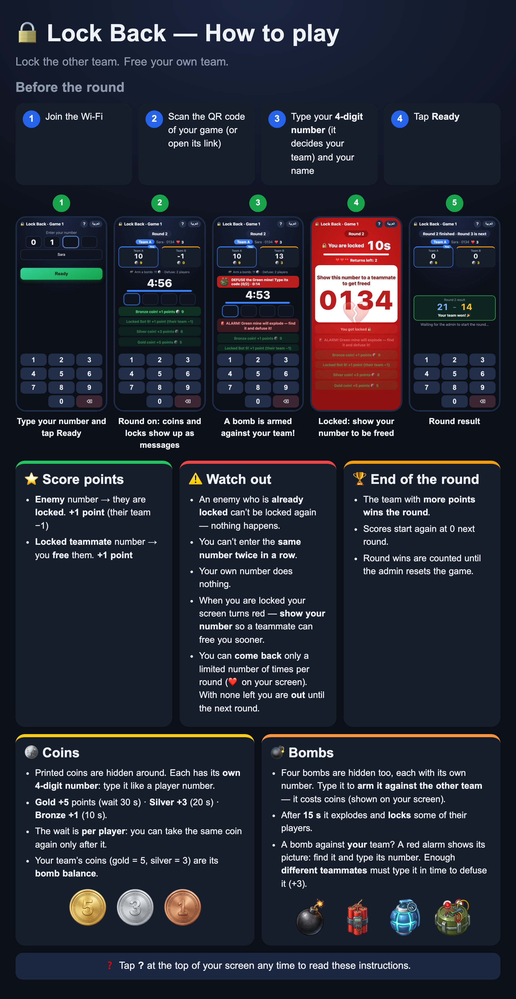
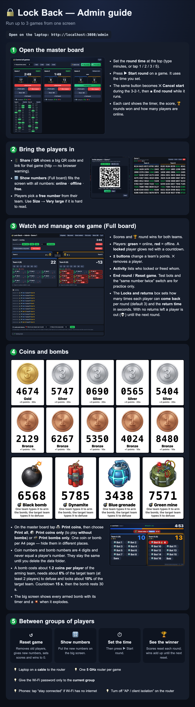

# Lock Back (لوك باك)

A real-time, two-team number game for phones on a local Wi-Fi network, built with Node.js, Express and Socket.IO. Each player has a secret 4-digit number. Type an enemy's number to **lock** them, type a locked teammate's number to **free** them, collect hidden **coins** for points and use **bombs** to lock several opponents at once. The team with more points wins the round. The interface is bilingual (Arabic / English). No internet connection is needed once installed.

Several games run side by side on one laptop (3 by default), so one event can host multiple groups.

## What you need

| Item | Details |
|---|---|
| Node.js | 18 or newer (22 recommended). Not needed if you use the standalone build |
| A laptop | Runs the server, the admin board and the big screen |
| Players' phones | Any modern phone browser. No camera or app needed |
| Network | One Wi-Fi network shared by the laptop and all phones (one 5 GHz router per game works best, laptop on a cable) |
| Printer (optional) | To print the coins and bombs (`print/*.pdf` or `/coins` in the admin) |

No accounts, API keys or external services are used.

## Install and run

```bash
npm install
npm start          # launcher + game server, plain HTTP
```

On macOS you can double-click `Start Lock Back.command`, on Windows `Start Lock Back.bat`. Both install the dependencies on first run, start the game and open the admin board at `http://localhost:3080/admin`.

Environment variables: `GAMES` (number of parallel games, 1-9, default 3), `PORT` (default 3000), `HTTP_PORT` (default `PORT + 80`, so `3080`), `LAUNCHER_PORT` (default 3001), `HTTPS=1` (also serve HTTPS with a self-signed certificate, generated into `data/cert.json`).

`npm run server` starts the game server without the launcher.

### Standalone build (no Node.js needed)

```bash
npm run build      # uses @yao-pkg/pkg -> dist/ (macOS arm64/x64 and Windows x64)
```

The binaries and zips are not kept in git (`dist/`, `release/` are ignored). Extract the zip, double-click the program, and a `data/` folder appears next to it. See `guide/src/README.txt`.

## How to run an event

1. Start the game on the laptop. The terminal prints a link and a QR code for every game.
2. Open `http://localhost:3080/admin` (the admin board for all games). Another device can open the admin with the secret link the server prints; the key changes on every start and can be reset from the board.
3. Project `http://localhost:3080/screen` (scoreboard of all games) or `/g/<n>/screen` (one game).
4. Print and hide the coins and bombs: `print/lock-back-all.pdf`, `lock-back-coins-only.pdf`, `lock-back-bombs-only.pdf`, or open `/coins` in the admin.
5. Players join the Wi-Fi, scan the QR code of their game (or open `/g/<n>/join`), type their 4-digit number (it decides the team) and their name, then tap **Ready**.
6. Start the round from the admin board.

Useful admin pages: `/g/<n>/admin` (one game), `/g/<n>/test` (all player, coin and bomb numbers), `/g/<n>/sim` (simulator that plays both teams to check changes).

Player numbers and printed coins are the same on every computer and **Reset never changes them** (they live in `data/*.json`), so printed sheets keep working.

## How to play

- **Goal:** lock the other team and free your own. The team with more points wins the round.
- **Lock:** type an enemy's number: they are locked, you get +1 point (their team -1). A player who is already locked can't be locked again.
- **Free:** type a locked teammate's number: you free them (+1 point). Locked players show their number so a teammate can free them.
- **Rules:** you can't type the same number twice in a row, and your own number does nothing. You can come back only a limited number of times per round (the hearts on your screen).
- **Coins:** printed coins are hidden around the venue, each with its own 4-digit number. Gold +5 points (30 s wait), silver +3 (20 s), bronze +1 (10 s). The wait is per player.
- **Bombs:** four hidden bombs, each with its own number. Typing one arms it against the other team (it costs your team's coins); after 15 s it explodes and locks some of their players. If a bomb is armed against you, find it and type its number: enough different teammates must do it in time to defuse it (+3).
- Tap **?** on the player screen any time to read the rules.

Illustrated guides for players and admins are in `guide/` (PNG and PDF, Arabic and English).




`router-plan/` has router placement diagrams for running several games at once.

## Project structure

```
server.js      Express + Socket.IO server, routes, admin links
launcher.js    Small supervisor with a start button and invite QR codes
room.js        Game rules and state (one room per parallel game)
auth.js        Admin access: the laptop itself, or a secret key link
coins.js       bombs.js   Coin and bomb definitions loaded from data/
paths.js       Where saved files live (also for the standalone build)
share.js       LAN addresses and QR generation
public/        Web pages (join, admin, screens, simulator) and artwork
data/          Player numbers, coins, bombs (committed); cert.json is generated (git-ignored)
guide/         How-to-play guides and the scripts that build them
print/         Printable coin and bomb sheets
router-plan/   Wi-Fi / router diagrams
```

License: MIT
